 

📍 Islamabad, Pakistan &nbsp;·&nbsp; 🟢 **Open to full-time, contract & freelance work**

---

## 👨‍💻 About Me

I'm a **Full Stack Engineer who also owns the deployment side**. I design the UI, build the frontend and backend, wire up real-time features, and prepare applications for cloud deployment through containerization and automated CI/CD pipelines.

I don't just write code. I build products that **load fast, rank on Google, scale under traffic, and bring in business** for the people who use them.

> 💡 *"A feature isn't done when it works on my machine. It's done when it's deployed, monitored, and making someone's business better."*

---

## 📊 Impact at a Glance

| 🚀 **20+** | 🌍 **3** | ⚡ **99+** | 🏢 **1** |
|:---:|:---:|:---:|:---:|
| Production websites delivered | Countries served 🇵🇰 🇸🇦 🇬🇧 | Lighthouse SEO score across projects | Agency founded & run (Scrupulous) |

**Industries I've built for:** eCommerce · Admin Dashboards · NGO · Blog CMS · AI Consultation · Professional Services · SaaS

---

## 🛠️ Tech Arsenal

**Frontend**

 

**Backend & Real-Time**

 

**Testing & Quality**
 

**DevOps & Cloud**

---

## 🚀 Featured Projects

### 🤖 TaskFlow AI
**A full-stack task management application with AI integration and real-time communication.**

- **Frontend:** Next.js 16, React, TypeScript
- **Backend:** Node.js, Express.js 5, TypeScript
- **Database & Caching:** MongoDB Atlas, Redis Cloud
- **Real-time:** Socket.IO for chat and notifications
- **AI Integration:** Google Gemini API
- **DevOps:** Docker, Docker Compose, GitHub Actions CI/CD, AWS
- **Testing:** Automated backend tests and Playwright E2E tests

**Engineering highlights**
- Authentication, Authorization, RBAC and protected routes
- REST API architecture and database integration
- Real-time communication and notifications
- Automated testing and CI/CD workflows
- Containerized frontend and backend services

🔗 **[View Repository](https://github.com/mussadiqkhan6886/TaskFlow_AI)**
🔗 **[Live Link](http://taskflow-alb-862843803.eu-north-1.elb.amazonaws.com/)**

## 🔄 How I Ship: Code to Cloud

```mermaid

flowchart LR
    A["Design UI/UX<br/>Figma"] --> B["Develop<br/>Next.js + Express"]
    B --> C["Integrate<br/>MongoDB + Redis + Socket.IO + Gemini"]
    C --> D["Test<br/>Automated Tests + Playwright"]
    D --> E["Containerize<br/>Docker + Docker Compose"]
    E --> F["Automate<br/>GitHub Actions CI/CD"]
    F --> G["Prepare AWS Deployment<br/>ECR + ECS Fargate + ALB"]
    G --> H["Deploy and Verify<br/>Health Checks + Logs"]
    H --> I["Monitor and Optimize<br/>Performance + SEO"]

    style F fill:#1d4ed8,color:#ffffff,stroke:#1d4ed8
    style G fill:#b45309,color:#ffffff,stroke:#b45309
    style H fill:#475569,color:#ffffff,stroke:#475569

```

## 🧠 How I Think

- **Business first.** Every technical choice should help the client's goal, not just look good in a code review.
- **Performance is a feature.** I treat speed, SEO and accessibility as part of the build, not a cleanup task.
- **Automate the boring stuff.** If I do it twice by hand, it goes into a pipeline.
- **Own it end to end.** From the first wireframe to the production server, I'm accountable for the result.
- **Keep learning in public.** I add new tools to real projects, not just tutorials.

---

## 🏗️ What I Build

| | |
|---|---|
| **eCommerce platforms** | Fast storefronts with payments, admin panels and SEO |
| **Admin dashboards** | Role-based, data-rich internal tools |
| **Real-time apps** | Live chat, notifications and presence with Socket.io + Redis |
| **Business websites** | Conversion-focused sites with 99+ Lighthouse SEO |
| **Cloud deployments** | Dockerized apps shipped through CI/CD on AWS |
| **AI SaaS** | AI SaaS applications that help people in their business |

---

## 📈 GitHub Stats

---

## 🌱 Currently

- 🔭 Exploring system design, AI and cloud architecture
- 🟢 **Open to full-time, contract and freelance roles** (Full Stack / Frontend / Backend)

---

## 🤝 Let's Work Together

Have a product to build, or a team that needs a full stack engineer who can also ship to the cloud? Let's talk.

