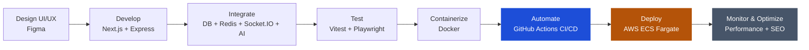

 

📍 Islamabad, Pakistan &nbsp;·&nbsp; 🟢 **Open to full-time, contract & freelance roles**

---

## 👨‍💻 About Me

I'm a **Full-Stack Engineer** who owns the full delivery cycle from UI/UX and clean API design to security, caching, real-time features, testing, containerization, and cloud deployment.

I don't just write code. I build products that **load fast, rank on Google, scale under traffic, and generate real business value**.

> 💡 *"A feature isn't done when it works on my machine. It's done when it's deployed, monitored, and making someone's business better."*

---

## 📊 Impact at a Glance

| 🚀 **20+** | 🌍 **3** | ⚡ **99+** | 🏢 **1** |
|:---:|:---:|:---:|:---:|
| Production websites delivered | Countries served 🇵🇰 🇸🇦 🇬🇧 | Lighthouse scores across projects | Agency founded & run (Scrupulous) |

**Industries I've built for:** eCommerce · Admin Dashboards · SaaS · AI Tools · Professional Services · NGO

---

## 🛠️ Tech Arsenal

**Frontend**

 

**Backend & Real-Time**

 

**Testing & Quality**

**DevOps & Cloud**

---

## 🚀 Featured Projects

### 🤖 TaskFlow AI — Distributed Task Management & Collaboration Platform
**Production-grade full-stack system with RBAC, real-time collaboration, AI, and cloud-native deployment.**

**Stack:** Next.js · TypeScript · Express · MongoDB · Redis · Socket.IO · Zod · Gemini API · Docker · GitHub Actions · AWS ECS Fargate

**Engineering Highlights**
- RBAC (Admin / Manager / Employee) with JWT access + refresh tokens in HTTP-only cookies and record-level ownership checks
- Redis cache-aside layer with role-based caching, SCAN-based invalidation, and layered rate limiting
- Real-time collaboration via Socket.IO (rooms, read receipts, notifications, cursor-based pagination)
- Gemini API integration for AI task summarization and priority classification
- 90%+ backend test coverage (225 automated tests) using Vitest, Supertest, React Testing Library & Playwright E2E
- 4-stage GitHub Actions CI/CD pipeline → Docker → Amazon ECR → AWS ECS Fargate via OIDC (no long-lived credentials)

🔗 [Live Demo](http://taskflow-alb-862843803.eu-north-1.elb.amazonaws.com) · [Repository](https://github.com/mussadiqkhan6886/TaskFlow_AI)

---

### 🛒 Lifestyle Shopping UK — Full-Stack E-Commerce Platform
**Live production store serving real customers with transactional integrity and high performance.**

**Stack:** Next.js · TypeScript · Express · PostgreSQL · Prisma · Zod · React Hook Form · Cloudinary · JWT

**Engineering Highlights**
- JWT-secured admin dashboard (products, orders, promo codes, reviews)
- Idempotent transactional checkout with server-side pricing, promo/shipping logic, and atomic stock updates (prevents overselling)
- Product pagination (<0.5s load) + debounced search
- COD + bank-transfer payments with Cloudinary proof upload
- HTTP-only JWT cookies, Zod + React Hook Form validation, rate limiting
- **100 Lighthouse Performance** + strong technical SEO

🔗 [Live Site](https://www.lifestyleshoppinguk.com) · [Repository](https://github.com/mussadiqkhan6886/lifestyle)

---

### 🍪 Chunk’d Cookies — Product-Drop E-Commerce
**Production store for a Lahore cookie brand with complex purchase flows.**

**Stack:** Next.js · TypeScript · MongoDB · Cloudinary · JWT

- Three purchase flows (single items, bundles, build-your-own box) + limited-edition drops
- Real-time box builder, coupon engine, city-based delivery pricing
- JWT-secured admin dashboard with revenue analytics and review moderation
- **100/100 Lighthouse Performance & SEO**

🔗 [Live Site](https://www.chunkdpk.com) · [Repository](https://github.com/mussadiqkhan6886/chunkd)

---

## 🔄 How I Ship: Code → Cloud

---

## 🧠 How I Think

- **Business first** — Every technical decision should move the client’s goal forward.
- **Performance is a feature** — Speed, SEO, and accessibility are part of the build, not a cleanup task.
- **Automate the boring stuff** — If I do it twice by hand, it goes into a pipeline.
- **Own it end to end** — From the first wireframe to production monitoring, I stay accountable.
- **Ship real systems** — Prefer production constraints (auth, caching, testing, CI/CD) over tutorial-level apps.

---

## 🏗️ What I Build

| | |
|---|---|
| **eCommerce platforms** | Fast storefronts with payments, admin panels, and SEO |
| **Admin dashboards** | Role-based, data-rich internal tools |
| **Real-time apps** | Live chat, notifications, and presence with Socket.IO + Redis |
| **Business websites** | Conversion-focused sites with 99+ Lighthouse scores |
| **Cloud deployments** | Dockerized apps shipped through CI/CD on AWS |
| **AI-powered products** | Practical AI features (summarization, classification, assistants) |

---

## 🌱 Currently

- Exploring system design, advanced caching patterns, and cloud architecture
- 🟢 **Open to full-time, contract, and freelance roles** (Full-Stack / Software Engineer)

---

## 🤝 Let's Work Together

Looking for a Full-Stack Engineer who can take a product from idea → production on the cloud?

